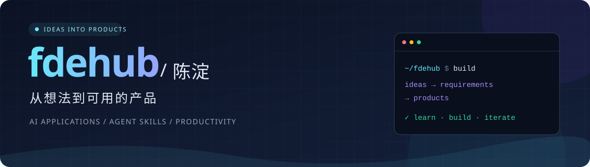
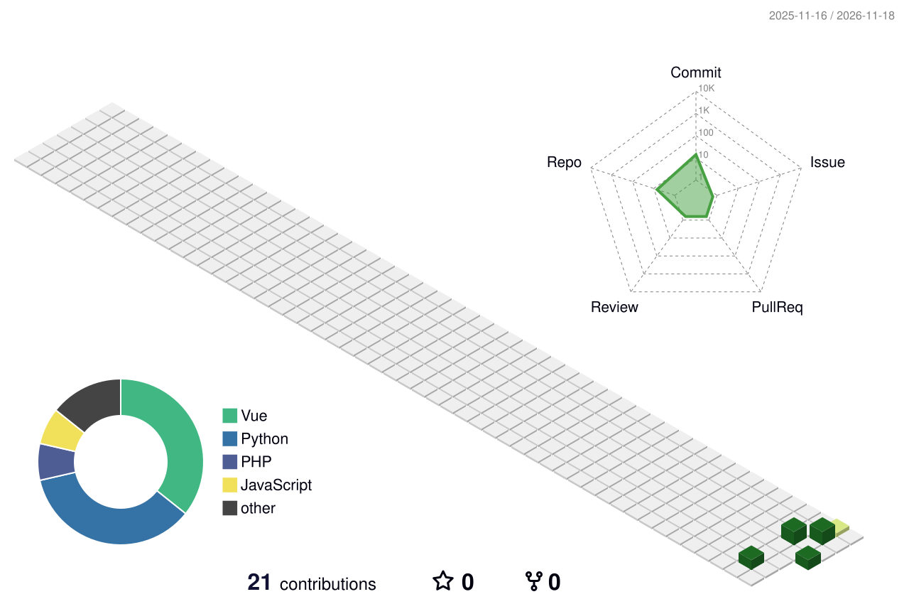

  

  

  <a href="#关于我">关于我</a> ·
  <a href="#项目精选">项目精选</a> ·
  <a href="#项目中的技术">项目中的技术</a> ·
  <a href="#贡献足迹">贡献足迹</a>

## 关于我

你好，我是 **陈淀 / fdehub**。这里记录我围绕 **AI 应用、产品需求和效率工具**的实践。

- **AI 创作**：从小说与故事创作，到语音识别和字幕工作台。
- **需求与协作**：将模糊想法整理成可实施、可验收的需求与开发提示词。
- **效率工具**：探索浏览器工作区管理，以及产品体验的自动化检查。

## 项目精选

<table>
  <tr>
    <td width="50%" valign="top">
      <h3>✦ AI 创作平台</h3>
      
小说与故事创作、人物世界观、大纲推演，以及 AI 漫剧分镜。支持自托管。

      
<code>Vue 3</code> <code>FastAPI</code> <code>SQLite</code>

      <a href="https://github.com/fdehub/ai-creation-studio">查看 ai-creation-studio →</a>
    </td>
    <td width="50%" valign="top">
      <h3>♫ 音流 · VoiceFlow Studio</h3>
      
多引擎并发 AI 语音识别与智能字幕工作台，将音视频内容转为文字与字幕。

      
<code>Python</code> <code>FastAPI</code> <code>React</code>

      <a href="https://github.com/fdehub/voiceflow-studio">查看 voiceflow-studio →</a>
    </td>
  </tr>
  <tr>
    <td width="50%" valign="top">
      <h3>⌘ 智窗 · TabFlow</h3>
      
Chrome 标签聚类与多窗口工作区管理，让浏览器里的资料更有条理。

      
<code>JavaScript</code> <code>Chrome Extension</code>

      <a href="https://github.com/fdehub/tabflow-extension">查看 tabflow-extension →</a>
    </td>
    <td width="50%" valign="top">
      <h3>◇ 需求文档 Skill</h3>
      
从模糊想法到可开发、可验收的 PRD，覆盖字段权限、接口契约与验收追踪。

      
<code>PRD</code> <code>Agent Skills</code> <code>Python</code>

      <a href="https://github.com/fdehub/prd-chendian">查看 prd-chendian →</a>
    </td>
  </tr>
  <tr>
    <td width="50%" valign="top">
      <h3>↗ Vibe Coding Skill</h3>
      
中文需求引导、开发提示词与实现协作，把产品想法逐步变成具体任务。

      
<code>Agent Skills</code> <code>Requirements</code>

      <a href="https://github.com/fdehub/vibe-coding-skill">查看 vibe-coding-skill →</a>
    </td>
    <td width="50%" valign="top">
      <h3>▣ TradePro</h3>
      
跨境电商交易系统与自动化体验质检，连接产品交互、交易流程和质量检查。

      
<code>PHP</code> <code>JavaScript</code> <code>Python</code>

      <a href="https://github.com/fdehub/tradepro-commerce-audit">查看 tradepro-commerce-audit →</a>
    </td>
  </tr>
</table>

## 项目中的技术

  
  
  
  
  
  
  
  

## 贡献足迹

<picture>
  <source media="(prefers-color-scheme: dark)" srcset="./assets/generated/snake-dark.svg" />
  <source media="(prefers-color-scheme: light)" srcset="./assets/generated/snake.svg" />
  
</picture>

  
我的 3D 贡献日历

   
  <picture>
    <source media="(prefers-color-scheme: dark)" srcset="./assets/generated/calendar-dark.svg" />
    <source media="(prefers-color-scheme: light)" srcset="./assets/generated/calendar.svg" />
    
  </picture>

贡献图每日自动更新 · 欢迎到项目的 Issues 交流想法

<!-- Visual inspiration: https://github.com/BEPb/BEPb (MIT). See CREDITS.md. -->
